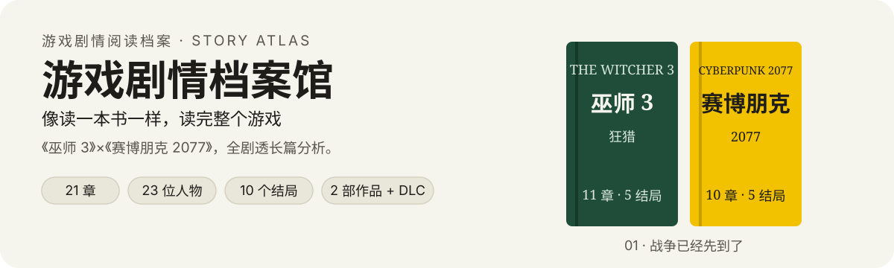
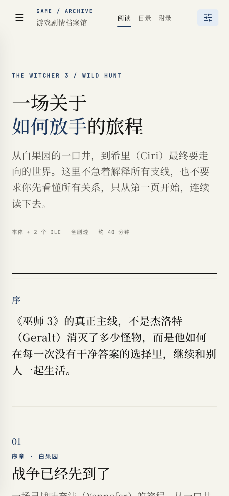

<p align="right"><a href="README.md">中文</a></p>

<p align="center">
  
</p>

<p align="center">
  <a href="https://xiaosang.cc/game-narrative-archive/">▶ Read Online</a>
  ·
  <a href="https://github.com/holynova/game-narrative-archive">GitHub Repository</a>
</p>

Story Atlas is a mobile-first reading archive for game narratives, currently covering The Witcher 3: Wild Hunt (Hearts of Stone, Blood and Wine) and Cyberpunk 2077 (Phantom Liberty). The main text reads like a novel, end to end; character relationships, choice consequences, ending matrices, and the analysis method live in the appendix. Not a checklist or walkthrough — a book of stories you can actually finish. Full spoilers, with a warning before entry.

## Screenshots

<p align="center">
  
</p>

## Contents

| Game | Chapters | Characters | Relationships | Key decisions | Endings |
|------|----------|------------|---------------|---------------|---------|
| The Witcher 3: Wild Hunt + 2 DLCs | 11 | 12 | 12 | 4 | 5 |
| Cyberpunk 2077 + Phantom Liberty | 10 | 11 | 11 | 4 | 5 |
| **Total** | **21** | **23** | **23** | **8** | **10** |

- **Continuous reading**: read from the first page to the last — chapter headings, rules, and folio counters provide rhythm without breaking the prose into cards or dashboards.
- **Appendix tools**: a relationship map, choice-to-ending map, ending matrix, DLC theme comparison, and a reusable 7-step method for analyzing any game's narrative.
- **Facts separated from judgment**: confirmed information, inference, and the author's framing are marked separately, and the text deliberately pauses at moral dilemmas.
- **Side quests and DLCs are not second-class**: they are part of the complete narrative and unfold naturally in the reading structure, not as side notes.
- **Chinese text**: the main text is in Chinese, with character names in their official Chinese translations.

## Run Locally

```bash
npm install
npm run dev      # development server
npm run build    # type check + production build
npm run preview  # preview the build output
```

Fully static — no backend, no accounts, no database.

## Tech

- React + TypeScript + Vite, with content separated from the interface: a new game only needs a new data file in the same shape, reusing the navigation and chart components.
- A folded-archive visual system (see `DESIGN.md`): paper background, folio rules, a single ink color with a few copper annotations; mobile-first, equally readable on desktop.
- See `PRODUCT.md` for the editorial principles and positioning.

```
src/data.ts            The Witcher 3: chapters / characters / relationships / choices / endings / DLC themes / analysis method
src/cyberpunkData.ts   Cyberpunk 2077 and Phantom Liberty, same structure
src/App.tsx            Unified reading UI for both games: Reading / Contents / Appendix
src/export.ts          Export logic
src/styles.css         Folded-archive visual system + mobile/desktop responsive layout
```
