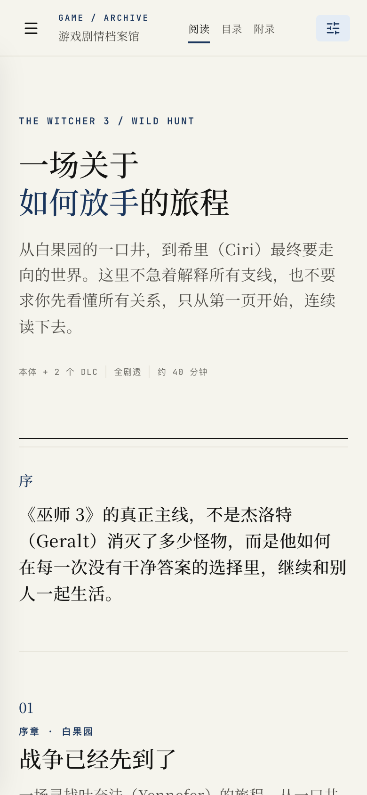

<p align="right"><a href="README.en.md">English</a></p>

<p align="center">
  
</p>

<p align="center">
  <a href="https://xiaosang.cc/game-narrative-archive/">▶ 在线阅读</a>
  ·
  <a href="https://github.com/holynova/game-narrative-archive">GitHub 仓库</a>
</p>

游戏剧情档案馆是一个手机优先的游戏剧情阅读档案：目前收录《巫师 3：狂猎》（含《石之心》《血与酒》）与《赛博朋克 2077》（含《往日之影》）。正文像小说一样连续读下去，人物关系、选择后果、结局矩阵和分析方法放在附录。这不是任务清单或通关攻略，而是一部可以读完的剧情书——全剧透，入口有剧透提醒。

## 截图

<p align="center">
  
</p>

## 内容

| 作品 | 章节 | 人物 | 关系 | 关键选择 | 结局 |
|------|------|------|------|----------|------|
| 《巫师 3：狂猎》+ 2 个 DLC | 11 | 12 | 12 | 4 | 5 |
| 《赛博朋克 2077》+《往日之影》 | 10 | 11 | 11 | 4 | 5 |
| **合计** | **21** | **23** | **23** | **8** | **10** |

- **连续阅读**：从第一页一路读到底，章节标题、规则线与页码提供节奏，不把正文拆成卡片和仪表盘。
- **附录工具**：人物关系图、选择—结局图、结局矩阵、DLC 主题对照，以及一套可迁移到其他游戏的 7 步剧情分析方法。
- **事实与判断分开**：确定信息、推断与作者的问题意识分别标记，在道德困境处有意停顿。
- **支线与 DLC 不降级**：它们是完整叙事的一部分，在阅读结构中自然展开，而非边角附注。
- **中文阅读**：正文为中文，人物名采用规范的官方中文译名。

## 本地运行

```bash
npm install
npm run dev      # 开发服务器
npm run build    # 类型检查 + 生产构建
npm run preview  # 预览构建产物
```

纯静态站，无后端、无账号、无数据库。

## 技术

- React + TypeScript + Vite，内容与界面分离：新增游戏只需按同一结构写数据文件，复用导航与图表组件。
- 折页档案视觉系统（见 `DESIGN.md`）：纸面底、书页规则、单一墨色加少量铜色批注；手机优先，桌面端同样可读。
- 产品定位与写作原则见 `PRODUCT.md`。

```
src/data.ts            巫师 3：章节 / 人物 / 关系 / 选择 / 结局 / DLC 主题 / 分析方法
src/cyberpunkData.ts   赛博朋克 2077 与《往日之影》的对应内容
src/App.tsx            双作品统一阅读界面：阅读 / 目录 / 附录
src/export.ts          导出逻辑
src/styles.css         折页档案视觉系统 + 手机/桌面响应式
```
