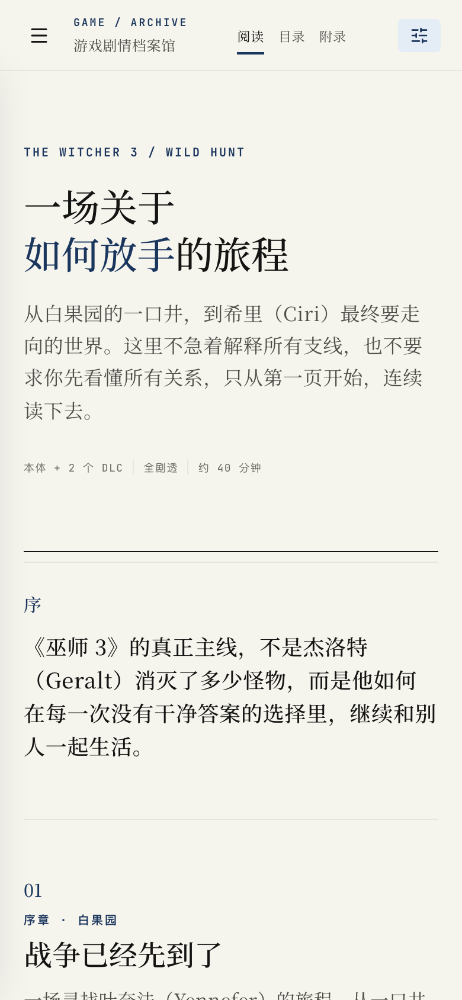

# 游戏剧情档案馆 · Story Atlas

一个手机优先的游戏剧情阅读档案：目前收录《巫师 3：狂猎》（含两个 DLC）与《赛博朋克 2077》（含《往日之影》）。正文像小说一样连续阅读，人物关系、选择后果、结局矩阵和分析方法放在附录。

## 阅读预览


<details>
<summary>查看移动端阅读界面</summary>



</details>

正文与附录包含剧情、关键选择和结局信息，适合通关后回顾或对照阅读。

## 本地运行

```bash
npm ci
npm run dev
```

开发服务器启动后，打开终端输出的本地地址。

生产构建与本地预览：

```bash
npm run build
npm run preview
```

## 内容结构

- `src/data.ts`：巫师 3 的剧情、人物、关系、选择、结局、DLC 对照和通用分析方法。
- `src/cyberpunkData.ts`：赛博朋克 2077 与《往日之影》的对应内容。
- `src/App.tsx`：统一的双作品阅读、目录和附录界面。
- `src/styles.css`：折页档案视觉系统，以及手机/桌面响应式布局。

## 后续扩展

新增游戏时，优先复用 `Chapter`、`Character` 和 `Relationship` 字段结构：

1. 核心问题与世界规则
2. 主线转折与重要支线
3. 人物动机与关系
4. 被延迟的选择与代价
5. 本体与 DLC 的主题变化
6. 结局矩阵

然后再把数据接入统一的导航和图表组件。
